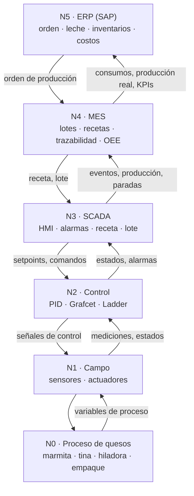

# Arquitectura de automatización (ISA-95) · Línea de quesos

Detalle completo: línea de quesos de pasta hilada (Q1 mozzarella, Q2 siete cueros,
Q3 quesillo). Yogures y UHT aparecen como bloques de la planta, sin detalle.

## Clasificación de procesos en la línea de quesos
| Tipo | Operaciones | Control |
|---|---|---|
| Continuo | Bombeo de leche, regulación de temperatura de camisa y de agua de hilado, temperatura de salmuera | Lazos PID |
| Batch | Tratamiento en marmita, ciclo de la tina (cuajo, coagulación, corte, desuerado), recetas | Grafcet, ISA-88 |
| Discreto | Moldeo de bloques, manejo en salmuera, empaque al vacío, codificación, encajonado, paletizado | Ladder, robot |

## Niveles 
| Nivel | Capa | Contenido en la línea de quesos | Estándar ISA-95 |
|---|---|---|---|
| N5 | ERP (SAP, conceptual) | Orden de producción, recepción de leche (4.200 L/día*), inventario de leche, cuajo y bolsas, costos | Nivel 4 |
| N4 | MES | Ejecución de lotes, descarga de recetas ISA-88, trazabilidad (lote, fecha, máquina), calidad, paradas, OEE, takt, throughput | Nivel 3 |
| N3 | SCADA (Ignition, por confirmar) | HMI ISA-101, estado de equipos y lote, variables, alarmas, tendencias, receta; OPC con el PLC | Nivel 2 |
| N2 | Control (Logix Emulate) | PID (camisa de tina, agua de hilado), Grafcet/Ladder (tina, hilado, empaque), recetas como parámetros | Nivel 2 |
| N1 | Campo | PT100, pH ISFET, firmeza, caudal, nivel, vacío, conteo óptico, detector de metales; válvulas, variador de liras, bombas, grúa | Nivel 1 |
| N0 | Proceso | Marmita → tina → hiladora → moldeo → salmuera → empaque al vacío → paletizado; servicios (vapor, agua helada, CIP) | Nivel 0 |

Frontera OT / IT: entre N3 y N4.

## Diagrama

## Flujo de información
| Enlace | Hacia abajo | Hacia arriba | Comunicación (propuesta) |
|---|---|---|---|
| N5 ↔ N4 | Orden: producto, cantidad, fecha | Consumos, cantidad real, lote cerrado | B2MML / servicios web |
| N4 ↔ N3 | Receta, lote, parámetros | Producción, calidad, paradas, trazabilidad | OPC UA / API |
| N3 ↔ N2 | Receta seleccionada, setpoints, comandos | Estados, alarmas, variables | OPC |
| N2 ↔ N1 | Salidas a válvulas, motores | Temperatura, pH, nivel, caudal, presencia | Cableado / EtherNet/IP |

## Ejemplo de lote (Q1 mozzarella, caso base*)
1. ERP emite orden de 1.680 bloques de 250 g (4.200 L, rendimiento 10 %*).
2. MES verifica leche, cuajo y bolsas, asigna la tina y descarga la receta Q1.
3. SCADA muestra producto y lote y envía los parámetros al PLC.
4. PLC ejecuta el Grafcet: atemperar, coagular, cortar, desuerar, hilar, salmuera.
5. Empaque reporta unidades buenas y rechazos hasta el MES.
6. MES cierra el lote, calcula OEE y trazabilidad; ERP descuenta insumos.

## Planta y recursos compartidos
Recepción, pasteurización HTST (72 °C, 15 s), silos, vapor, agua helada y CIP son
compartidos con las líneas de yogures y UHT, que entran a la arquitectura como bloques.

(*) Supuestos académicos.
