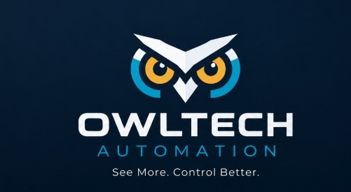

  
  <h1>OwlTech Automation</h1>
  <h3><i>See More. Control Better.</i></h3>

---

**Propuesta de Transformación Digital Industrial (TDI)** para una planta de derivados lácteos con tres líneas por lotes: yogures, quesos y leche UHT / bebidas lácteas. 

*Proyecto Integrador · Automatización de Procesos de Manufactura 2026-2S · UNAL Bogotá.*

🔗 **Página web:** _[URL de GitHub Pages]_  
🎥 **Video de sustentación:** _[URL de YouTube]_

---

## 🏭 Sobre OwlTech Automation

OwlTech Automation es una empresa integradora de soluciones de Transformación Digital Industrial conformada por ingenieros mecatrónicos. Analizamos el sistema productivo como un todo y lo conectamos desde el proceso hasta la gestión empresarial.

### Cómo trabajamos
**VISIÓN DEL PROCESO → GESTIÓN DEL PROCESO → AUTOMATIZACIÓN DEL PROCESO**
- **See More (ver más):** Entender el proceso, medirlo y visualizarlo (VSM, KPIs, SCADA).
- **Control Better (controlar mejor):** Automatizar con control lógico-secuencial, robótica y recetas ISA-88 integradas a MES y ERP bajo ISA-95.

### Cliente y problema
Una empresa del sector lácteo necesita modernizar su planta para mejorar la integración de procesos, la flexibilidad, la trazabilidad y la toma de decisiones basada en datos.

### Alcance de nuestra propuesta
- Planta con tres líneas por lotes (yogures, quesos, leche UHT/bebidas), con mínimo tres referencias por línea.
- Recepción de materias primas hasta almacenamiento y despacho.
- Arquitectura ISA-95/ISA-88, VSM antes/después, simulación y evaluación técnico-económica.
- Automatización y gemelo digital detallados en una línea (entrega final).

---

## 📂 Estado del Proyecto

| Carpeta | Contenido | Estado |
|---|---|---|
| `00 Pagina Web` | Estructura y desglose de la página | 🟡 En desarrollo |
| `01 TDI` | ISA-95, ISA-88, recetas, instrumentación | 🟡 En desarrollo |
| `02 Gestion Produccion` | VSM, KPIs, simulación | 🟡 En desarrollo |
| `03 Planeación` | EDT, cronograma, presupuesto | 🟡 En desarrollo |
| `04 Layout y Diagramas` | Layout, diagramas de proceso | 🟡 En desarrollo |
| `05 Recetas` | Recetas Q1-Q3, Y1-Y3, L1-L3 | 🟡 En desarrollo |

---

## 📌 Convenciones
- **Niveles ISA-95** *(diapositivas Módulo 1)*: N0 Proceso · N1 Campo · N2 Control · N3 SCADA · N4 MES · N5 ERP.
- **Referencias:** **Q** = Quesos, **Y** = Yogures, **L** = Leche UHT/Bebidas.
- **Supuestos:** Las cifras marcadas con `(*)` son supuestos académicos, no datos de una planta real.

---

## 👥 Equipo de Ingeniería

<table align="center">
  <tr>
    <td align="center" width="33%">
       
      <b>Duvan Stiven Tique Osorio</b> 
      <i>CEO</i>
    </td>
    <td align="center" width="33%">
       
      <b>Julian David Benitez Martinez</b> 
      <i>CTO</i>
    </td>
    <td align="center" width="33%">
       
      <b>Miguel Angel Ortiz Mejia</b> 
      <i>CCO</i>
    </td>
  </tr>
  <tr>
    <td align="center" valign="top">
      Gestión del proyecto: EDT, cronograma, integración de módulos y entregables, relación con el cliente.
    </td>
    <td align="center" valign="top">
      Automatización: celda robotizada, control lógico-secuencial.
    </td>
    <td align="center" valign="top">
      Propuesta de valor, oferta comercial, imagen corporativa, página web y video.
    </td>
  </tr>
  <tr>
    <td align="center" width="33%">
       
      <b>David Santiago Pirateque Suarez</b> 
      <i>COO</i>
    </td>
    <td align="center" width="33%">
       
      <b>Maria Fernanda Morillo Tovar</b> 
      <i>CIO</i>
    </td>
    <td align="center" width="33%">
       
      <b>Juan Felipe Salamanca Lancheros</b> 
      <i>CFO</i>
    </td>
  </tr>
  <tr>
    <td align="center" valign="top">
      Gestión de la producción: VSM, OEE, Takt Time, Throughput, MLT.
    </td>
    <td align="center" valign="top">
      Arquitectura ISA-95/ISA-88, flujo OT-IT e integración de información.
    </td>
    <td align="center" valign="top">
      Presupuesto, flujo de caja, indicadores financieros, viabilidad.
    </td>
  </tr>
</table>

---

## 🛠 Organización del Trabajo
- **Reuniones y actas:** Consultar directorio `gestion_equipo/actas/`
- **Evidencias de participación:** Historial de *commits* y entregables por integrante en `gestion_equipo/evidencias.md`
- **Flujo de trabajo:** Cada integrante realiza *commits* de manera modular en la carpeta correspondiente a su área de responsabilidad.

## Estructura de Desglose del Trabajo (EDT)

### 1. Planeación del proyecto
- **1.1.** Definición del problema, objetivos y alcance.
- **1.2.** Elaboración de la EDT y el cronograma.
- **1.3.** Asignación de responsables y seguimiento del proyecto.

### 2. Análisis y gestión de la producción
- **2.1.** Caracterización de las tres líneas, equipos y recursos compartidos.
- **2.2.** Diagramas de proceso y análisis de tiempos, capacidades, cambios y paradas.
- **2.3.** Cálculo de indicadores actuales: OEE, Takt Time, Throughput, MLT, utilización y calidad.
- **2.4.** Elaboración del VSM actual e identificación de oportunidades de mejora.
- **2.5.** Modelado y simulación de las tres líneas en Siemens Tecnomatix.
- **2.6.** Evaluación de escenarios futuros y comparación de indicadores.
- **2.7.** Definición de estrategias de mantenimiento preventivo, correctivo y predictivo.

### 3. Transformación Digital Industrial (TDI)
- **3.1.** Elaboración de los modelos físico y procedimental ISA-88.
- **3.2.** Definición de recetas, parámetros y lotes de producción.
- **3.3.** Diseño de la arquitectura de integración ISA-95.
- **3.4.** Identificación de sensores, actuadores, variables y comunicaciones industriales.
- **3.5.** Definición del flujo de información entre proceso, control, SCADA, MES y ERP.

### 4. Diseño de planta e instrumentación
- **4.1.** Elaboración del layout general y distribución de recursos.
- **4.2.** Elaboración de los diagramas técnicos de instrumentación de la solución seleccionada.
- **4.3.** Diseño de la celda robotizada y su flujo de materiales.
- **4.4.** Análisis de riesgos y definición de medidas de seguridad de la celda.
- **4.5.** Simulación de la celda en RobotStudio.

### 5. Automatización y supervisión
- **5.1.** Elaboración del GRAFCET e implementación del control en Ladder.
- **5.2.** Configuración de parámetros y recetas en el sistema de control.
- **5.3.** Desarrollo del gemelo digital de la línea seleccionada.
- **5.4.** Integración con Logix Emulate y validación de diferentes lotes y recetas.
- **5.5.** Diseño de la HMI bajo ISA-101 y configuración del SCADA en Ignition.
- **5.6.** Integración mediante OPC y validación funcional del sistema.

### 6. Evaluación y presentación de la propuesta
- **6.1.** Elaboración del presupuesto y recopilación de cotizaciones.
- **6.2.** Estimación de costos, ahorros y beneficios esperados.
- **6.3.** Elaboración del flujo de caja y cálculo de VAN, TIR y periodo de recuperación.
- **6.4.** Comparación de resultados actuales y proyectados.
- **6.5.** Elaboración del resumen ejecutivo y propuesta de valor.
- **6.6.** Organización del repositorio, desarrollo de la página web y preparación del video final.

